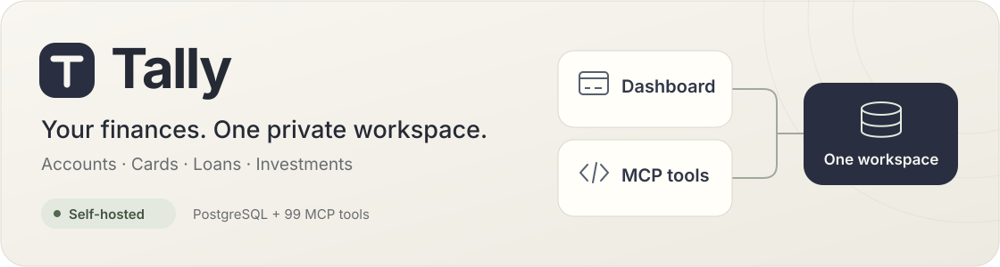
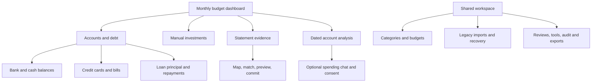
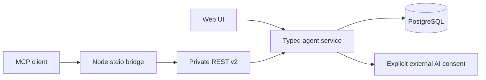

<p align="center">
  
</p>

# Tally

**Your finances, in one private workspace.**

[Features](#what-you-can-track) · [Setup](#setup) · [MCP connection](#mcp-connection) · [Architecture](#architecture) · [Contributing](#project-instructions) · [Coverage & limitations](docs/ui-ux-review.md)

A self-hosted finance dashboard with MCP tools backed by the same PostgreSQL service. Track bank and cash accounts, credit cards, loans, monthly budgets and manually valued investments from the website or an MCP client.

| At a glance     |                                                         |
| --------------- | ------------------------------------------------------- |
| **Workspace**   | One person's shared finances                            |
| **Storage**     | PostgreSQL is the source of truth                       |
| **Access**      | Private tailnet mode, with no app login or token prompt |
| **MCP catalog** | 99 tools with statements enabled; 83 without            |

INR and USD have independent balances, settings and histories. Financial records are loaded and saved on the server; the dashboard does not maintain a browser-local ledger or silently import old browser data.

> [!NOTE]
> The source is public. Your deployed application and financial data should remain behind private ingress. All permitted peers in shared tailnet mode have the same authority.

## What you can track

| Area                     | What it does                                                                           | Open in the app                |
| ------------------------ | -------------------------------------------------------------------------------------- | ------------------------------ |
| **Everyday budget**      | Income, expenses, categories, goals and monthly limits                                 | Dashboard                      |
| **Accounts & debt**      | Bank/cash accounts, institution details, dated openings, transfers and loan repayments | Accounts & debt                |
| **Credit cards**         | Recorded outstanding, limits, dated bills, minimums and payments                       | Accounts & debt → Credit cards |
| **Investments**          | Mutual funds, gold, stocks and recurring deposits; manual valuation history            | Investments                    |
| **Statements & imports** | Reviewed CSV/text-PDF staging, mapping, matching and reconciliation                    | Statements / Legacy imports    |
| **Analysis & exports**   | Dated account reports, cash movement, CSV/PDF/JSON downloads                           | Analysis / More / Tools        |

**Current status:** these features are merged into `main` and activated on the private deployment. Discover the actual service's capabilities before use; source updates, tool discovery and deployment are separate operations. Some advanced operations still use JSON rather than dedicated forms; see the [UI/UX review](docs/ui-ux-review.md).

<details>
<summary><strong>Detailed feature → UI → MCP coverage</strong></summary>

| Feature                                                                          | Web interface                                                        | MCP/service support                                           |
| -------------------------------------------------------------------------------- | -------------------------------------------------------------------- | ------------------------------------------------------------- |
| Monthly income/expense, savings goals, category limits and spending chart        | Dashboard; legacy budget in workspace                                | Transaction, monthly settings, summary and budget tools       |
| Multiple bank, cash, card and loan accounts                                      | Accounts & debt                                                      | Account create/read/update/archive/restore and opening tools  |
| Account name, bank/institution and last four digits                              | Account creation and Edit account details                            | `prepare_account`, `prepare_account_update`                   |
| Dated openings and explicit corrections                                          | Accounts & debt                                                      | Frozen account preview → `commit_account_change`              |
| Purchases, salary, transfers, ATM, refunds and reversals                         | Record money movement; advanced operations in Tools                  | Journal prepare/commit/reversal and history                   |
| Card outstanding, limit, available credit, dated bill/minimum/remaining due      | Accounts & debt → Credit cards                                       | Account update/read plus `card_payment` journal events        |
| Loan principal, borrowing, repayments with interest/fees                         | Accounts & debt → Loans & debt                                       | `loan_borrowing` / `loan_payment` journal events              |
| Account income/expense and bank/cash movement                                    | Analysis, with explicit report dates                                 | `get_income_expense_report`, `get_cash_flow`                  |
| Investment accounts, mutual funds, gold, stocks and RDs                          | Investments                                                          | Portfolio/history and investment prepare/commit tools         |
| Dated valuation corrections, quantity, cost basis, archive/restore, RD estimates | Investments                                                          | Append-only observations; paginated valuation history         |
| Account statement sources, mapping, classification, matching and reconciliation  | Statements; some advanced decisions still require JSON               | 16 statement/migration tools, enabled explicitly              |
| CSV/text-PDF import of unassigned budget records and JSON recovery               | Legacy imports                                                       | Upload/stage/map/correct/preview/commit, export/restore tools |
| Categories and monthly budgets                                                   | Dashboard and Categories                                             | Create/rename/archive/restore and budget tools                |
| CSV, monthly PDF, JSON and accounting exports                                    | Dashboard More; Accounts/Investments export; Tools                   | Expiring private download handles                             |
| Approvals, consent, operations, audit and legacy undo                            | Reviews and Advanced tools; not every operation has a dedicated form | Scoped approval/receipt/audit/undo tools                      |
| Optional spending chat                                                           | Spending chat                                                        | Context-bound external AI consent and request lifecycle       |

Tool names above omit the `tally_` prefix for readability. See the [generated tool schemas](skills/tally/references/tools.json), [bundled operating skill](skills/tally/SKILL.md), [UI/UX coverage review](docs/ui-ux-review.md), and [all-tool UI inventory](docs/tool-ui-coverage.md).

</details>

## Accounting and scope

- Account balances come from reviewed openings and balanced journals. Missing openings mean **unknown**, not zero.
- Transfers, card repayments and loan principal are not counted again as spending. Borrowing is not income; recorded interest/fees are expenses.
- The original dashboard reports **unassigned budget transactions**. Account journals are a different record model within the same server workspace. They are not added together automatically. Migration requires explicit reviewed mapping.
- Card statement due is a dated observation, distinct from current recorded debt. Only recorded card settlements after statement day reduce its remaining due. Pending or unrecorded bank activity is excluded.
- Investments are **manual dated observations**, not live quotes/NAV or a trade ledger. Values stay separate from bank/card net position. RD maturity values are manual estimates. See [tracking semantics](docs/investment-tracking.md).
- There is no bank/broker connection, automatic EMI/amortisation, tax/realised-return engine, investment cash posting, SIP/RD auto-debit, reminder worker, hosted HTTP MCP/OAuth or built-in tool-running agent.
- Statement/migration review has functional foundations but remains an advanced interface. Scanned/encrypted PDFs and OCR are unsupported. Financial imports are never inferred from files or browser storage.

<details>
<summary><strong>Explore the application map</strong></summary>



</details>

## Architecture



React 19, TypeScript, TanStack Start/Router, Tailwind and Recharts provide the UI. `src/lib/agent-tools/service.ts` owns financial operations; `catalog.ts` validates their schemas. PostgreSQL locks the canonical workspace and commits changes, revisions, receipts and audit together. Accounts, journals and statements also use normalized tables. Investment history extends the canonical workspace document. No migration runs as part of an application build.

Private shared `tailnet` mode uses the existing trusted private ingress and one shared workspace principal, with **no application login or token prompt**. Every permitted peer has the same authority; this is not per-user or per-agent isolation. Financial writes keep frozen previews, revision/hash checks and durable idempotency, without an extra owner-approval click. Bearer mode retains its scoped owner approvals. External AI sharing still requires explicit consent in either mode.

## Setup

### 1. Install dependencies

- Node.js **22.13 or newer** (deployment/CI target Node 22), npm 10+.
- PostgreSQL 17 for durable shared operation; Docker/Compose for the documented self-hosted target.
- The Node MCP bridge also requires this checkout's installed dependencies.

```sh
npm ci
npm run typecheck
npm test
npm run lint
```

No secrets belong in source, `.env`, browser storage, URLs, screenshots or prompts. Supply runtime secrets from a protected process environment or selected `*_FILE` secret files.

### 2. Configure PostgreSQL and private access

| Variable                             | Purpose                                                                       |
| ------------------------------------ | ----------------------------------------------------------------------------- |
| `TALLY_AGENT_ENABLED=true`           | Enable the service                                                            |
| `TALLY_AGENT_DATABASE_URL` / `_FILE` | Runtime PostgreSQL connection; use a restricted role                          |
| `TALLY_AGENT_PUBLIC_ORIGIN`          | Exact canonical origin, without the app path                                  |
| `TALLY_AGENT_AUTH_MODE`              | `tailnet` for existing private shared access, or `bearer`                     |
| `TALLY_AGENT_WORKSPACE_ID`           | Stable workspace identifier in private shared mode                            |
| `TALLY_AGENT_TRUSTED_PROXY_IPS`      | Exact verified proxy socket IPs, never a wildcard or client-supplied identity |
| `TALLY_AGENT_GRANTS_JSON` / `_FILE`  | Scoped token verifiers in bearer mode; unnecessary for tailnet mode           |
| `TALLY_STATEMENTS_ENABLED=true`      | Explicitly enable the statement/migration tools                               |

Provision a new PostgreSQL database and roles deliberately; do not point setup/QA at an existing financial database. Following the [database role setup](deploy/hub/README.md#runtime-role-on-a-new-database), and using migration-role credentials supplied privately, apply the checksum-tracked `migrations/agent-tools/0001`–`0004` migrations:

```sh
TALLY_AGENT_ENABLED=true npm run agent:migrate
```

The connection must already be supplied through `TALLY_AGENT_DATABASE_URL` or its file variable. Switch to the restricted runtime role afterwards. See [deployment setup](deploy/hub/README.md); back up an existing database before release changes. Migrations are an operator action, not a browser request or build side effect.

### 3. Build and run

```sh
npm run build        # default platform build
npm run build:hub    # standalone Node output, /finance/ base path
```

The standalone build produces `.output/`. Run `node scripts/start-tally.mjs` from that runtime directory, or use the provided Dockerfile/Compose files. The runtime launcher resolves selected secret files; directly invoking the generated server entry bypasses that launcher. Production uses a loopback host binding behind existing private HTTPS ingress. Do not expose the app/database publicly or widen listeners to solve a connection problem.

### Development and synthetic demos

Keep local development/preview servers off unless explicitly authorized by the operator. The commands below document setup; they are not an instruction for an agent to start them automatically.

For an explicitly authorized synthetic demo, `npm run dev:agent-fixtures` starts loopback-only development with synthetic in-memory records and a local provider stub. It does not test durable PostgreSQL or real external AI. For a normal durable development instance, configure the shared service below, then use `npm run dev`. Running `npm run dev` without shared storage does **not** turn the dashboard into a browser-local app. Vite development reads direct process environment variables; the production launcher resolves the selected `*_FILE` secret variables.

## MCP connection

In an MCP client, set the command to the absolute path of your Node executable, arguments to `["--experimental-strip-types", "/absolute/path/to/tally/scripts/tally-mcp.ts"]`. Replace the example script path with this checkout’s absolute path; the absolute argument also works in clients without a working-directory setting. Use Node directly so npm banners do not enter the stdio protocol. For clients using an `mcpServers` configuration, the shape is:

```json
{
  "mcpServers": {
    "tally": {
      "command": "/absolute/path/to/node",
      "args": ["--experimental-strip-types", "/absolute/path/to/tally/scripts/tally-mcp.ts"],
      "env": {
        "TALLY_URL": "https://<your-host>.<your-tailnet>.ts.net/finance/",
        "TALLY_AUTH_MODE": "tailnet"
      }
    }
  }
}
```

Other clients may expose separate command, arguments and environment fields. The connection environment is:

```text
TALLY_URL=https://<your-host>.<your-tailnet>.ts.net/finance/
TALLY_AUTH_MODE=tailnet
```

For a bearer deployment, use `TALLY_AUTH_MODE=bearer` and supply `TALLY_ACCESS_TOKEN` privately. The **client** mode variable differs from server-side `TALLY_AGENT_AUTH_MODE`. Never copy an exposed credential. Restart/refresh client discovery after a catalog update.

Begin with `tally_get_capabilities`, `tally_get_service_status` and `tally_list_ledgers`; discovery does not prove persistence readiness. The same service is available through `npm run agent:cli -- discover` (with the same configured client environment). The bridge is stdio over private REST; no hosted Streamable HTTP endpoint is claimed.

## Project instructions

Read [AGENTS.project.md](AGENTS.project.md) before changing this checkout. Preserve the original dashboard design, private ingress, server-only financial state, independent currencies, frozen intent/revisions and append-only financial history. Use disposable synthetic workspaces for mutations. Keep real records and legacy browser data untouched unless explicitly selected by the owner. Do not inspect/change unrelated agent installations or configure/call AI providers as part of UI QA.

Useful entry points:

- `src/components/budget/`: dashboard, account/card, statement, investment and analysis UI.
- `src/lib/accounting.ts`, `investments.ts`, `statements.ts`: financial semantics.
- `src/lib/agent-tools/`: contracts, service, transport, storage and tests.
- `src/styles.css`: shared palette, typography, fields, buttons and layout foundations.
- `skills/tally/`: installable operating instructions and generated schemas.
- `migrations/agent-tools/`: persistent schema; never rewrite applied migrations.
- `deploy/hub/`: portable private deployment files; keep live secrets/config outside Git.

## Verify, sync and deploy

```sh
npm run typecheck
npm test
npm run lint
npm run build
npm run build:hub
npm run agent:catalog
git diff --check
```

Browser QA must inspect real rendered pages, forms, previews, errors and desktop/tablet/mobile screenshots. Test both UI and actual SDK MCP calls against the compiled runtime and a disposable database; a passing schema test or HTTP 200 alone is insufficient. Record exact coverage and gaps in [UI/UX review](docs/ui-ux-review.md). A disabled provider is an expected state, not a tested AI response. Keep generated runtime files, screenshots, dumps and private QA evidence out of Git.

To synchronize authorized changes, inspect `git status`, fetch the remote, review divergence, commit only reviewed source/public documentation and push the intended branch. Preserve local work. History rewriting requires explicit owner authorization and a private recovery backup. Update generated tool schemas when contracts change. Do not publish private deployment inventories, personal figures or secrets in commit/PR descriptions. A push does not deploy or merge; report all three states separately.

For an existing installation, follow the [release checklist](deploy/hub/README.md#existing-installation--release): take a protected database backup, build and test a candidate, activate only the finance image, then verify live UI and MCP discovery. Preserve the gateway, database, runtime secrets and private network configuration. Retain a working rollback image and backup before removing old releases or build cache.

## Recovery

Retain database backups and source evidence before rollout. Legacy JSON restore applies only to the matching unassigned currency ledger; it is not a complete accounting/investment database restore. Accounting exports include journal/investment history but do not introduce a general restore UI. Restore PostgreSQL only as a deliberate operator action tested against an isolated copy. Old browser storage is not automatically read, migrated or deleted.

The [resume checkpoint](docs/RESUME-CHECKPOINT.md) and [feature/UX review](docs/ui-ux-review.md) describe current work. Older design/deployment notes are historical where they conflict with this README or the checkpoint.
