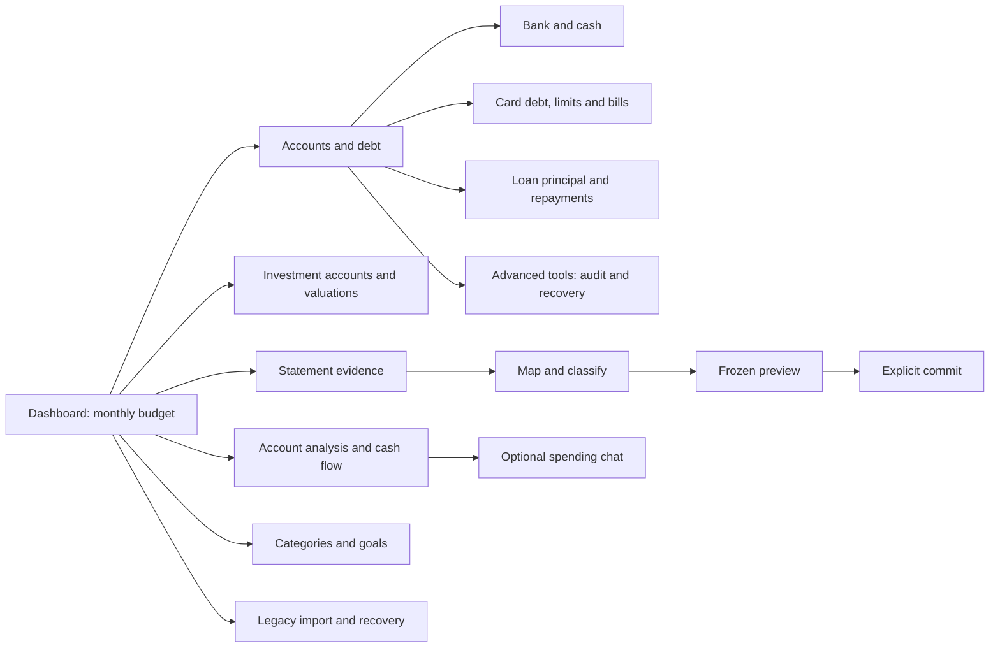

# Application and UI/UX review

This review covers the current source candidate, including multiple accounts, enhanced cards, manual investments and the new analysis/navigation work. It does not claim that the candidate has been deployed. Test records and screenshots are synthetic; no real financial records or external AI calls are used.

## Journey and design coverage

The application has one warm neutral palette, navy actions, consistent borders/rounded panels, typography and 44px minimum primary controls. The existing budget dashboard is retained. Desktop forms use columns and mobile forms stack. Monetary reports state currency/date/scope and keep budget records, journals and investment observations distinct.

The shared workspace is more utilitarian than the dashboard. It has functioning forms and a consistent visual system, but it is not polished consumer UX for every operation. The gaps below are part of the result, not implied completed features.

| Area                       | Designed UI / usability                                                                                        | Remaining gap                                                                                                                                    |
| -------------------------- | -------------------------------------------------------------------------------------------------------------- | ------------------------------------------------------------------------------------------------------------------------------------------------ |
| Dashboard                  | Summary, savings goal, budget limits, chart, entry editor, filters, month/currency navigation, data actions    | Budget-focused rather than a unified finance overview; reports unassigned records, with no automatic consolidation/migration of account journals |
| Navigation                 | Prominent financial-view links; workspace opens Accounts; active section indication and URL-backed sections    | Phone section picker plus five primary desktop views; secondary sections are grouped under More                                                  |
| Bank/cash accounts         | Create account/opening, date-based position, account filters, edit name/institution/last-four, archive/restore | First-opening action reuses fields below; selected account activity detail is limited                                                            |
| Credit cards               | Dedicated filter, debt, limit/available credit, dated bill/minimum/due status, explicit repayment              | No statement-cycle calendar, pending bank feed or reminder delivery                                                                              |
| Loans/debt                 | Dedicated filter, principal outstanding, borrowing and principal/interest/fee entry                            | No loan terms, APR, EMI plan, amortisation or payoff projection                                                                                  |
| Investments                | Named accounts; four holding types; quantity/cost/value; dates/history; archive/restore; RD estimates          | Manual observations only; no quotes, trades, cash linkage, realised/tax return                                                                   |
| Analysis                   | Dated journal income/expense and bank/cash movement with named accounts and clear scope                        | No account-category/merchant trend drilldown or consolidated FX/investment performance chart                                                     |
| Reviews                    | Human-readable amounts and labels; complete frozen JSON retained; explicit commit/cancel                       | Very large nested reviews still require inspecting full details; no virtualized review grid                                                      |
| Statements                 | Account/period/source upload, retained rows, matching/coverage/reconciliation and grouped review               | Mapping, classification and legacy conversion require JSON decisions; not a complete guided consumer wizard                                      |
| Legacy import/recovery     | Upload, mapping, rows, preview and explicit commit                                                             | Mapping/correction JSON and native prompts remain advanced; full accounting restore is an operator task                                          |
| Categories                 | Create/rename/archive/restore; budgets on dashboard                                                            | Rename still uses a native prompt; the new-category name field has an accessible name but should gain a visible caption                          |
| Spending chat              | Provider readiness, question/context review, external-sharing consent, response/cancel                         | Provider disabled in this environment; no real external answer was tested. Not a built-in tool-running agent                                     |
| Tools and operations       | Schema-aware console and raw results; scoped service contracts                                                 | Audit timeline, receipts, integrity, undo, preferences and batch operations lack dedicated friendly screens                                      |
| Exports                    | CSV, PDF and JSON download actions; accounting/investment backup                                               | Export is not proof of a complete backup/restore UI or restore rehearsal                                                                         |
| Empty/loading/error states | Server loading/failure, unknown openings, no accounts/holdings, stale preview rejection, disabled provider     | Field-specific validation and richer empty-state guidance can improve further                                                                    |

## Changes made during this audit

- Replaced outdated browser-local README/setup instructions and added project-specific instructions.
- Replaced the crowded phone menu with a labeled section picker. Desktop shows Dashboard, Accounts & debt, Investments, Statements and Analysis, with secondary sections grouped under More.
- Made Accounts & debt the workspace default and added prominent Dashboard/Analysis navigation, selected-state semantics, deep-link updates and an explicit workspace refresh. Relabeled the review area for consent.
- Added loan/card/bank/cash filters and explicit loan principal wording; clarified borrowing/repayment labels.
- Added an account-details editor for name, bank/institution and masked identifier, preserving frozen intent revision.
- Added dated journal and bank/cash analysis using existing service tools, rejecting mixed-revision reads. Replaced the dashboard’s permanently disabled legacy chat widget with links to the working canonical analysis/consent flow.
- Replaced raw-only frozen review displays with readable labels and formatted money, retaining the exact full payload.
- Improved wrapping, minimum sizing and narrow-layout controls without hiding financial overflow. All single-select fields share one chevron, size and text spacing; More menus use matching SVG chevrons rather than text glyphs. Generated QA artifacts no longer pollute the lint gate.
- Prevented narrow dashboard currency-label clipping: phone Add entry has its own row, tablet controls wrap, and the full selected currency text is measured in responsive QA.
- Added explicit accessible names to account selectors and changed workspace form date defaults from UTC to the browser’s local calendar day.

## Verification record

The compiled ARM64 standalone candidate passed the full isolated application audit. A subsequent visual review found dashboard currency-label clipping at phone/tablet widths; the final header-only adjustment received a separate five-width compiled-runtime regression check. Financial service code was unchanged between these runs. The local suite has **350 cases: 348 passed, two skipped, zero failed**; the two skips concern unavailable optional brand-skill instructions. Typecheck, full lint and the default platform build pass. The standalone build passes separately. Runtime/check source fingerprints matched 156 files with zero mismatches.

The integration driver discovered all **99 contracts** and made **117 actual MCP calls across 40 distinct tools** through the official SDK stdio bridge, verified fixture TLS, synthetic private ingress, the compiled application and PostgreSQL 17. Financial records were created through service/browser operations, with no financial SQL seeds. Covered workflows include:

- Bank/card/loan creation, institution/last-four editing, openings and loan drawdown/principal/interest arithmetic; UI records read back through MCP.
- Four investment types, dated observations, browser preview without posting, explicit valuation commit, history paging, stale-preview rejection/cancellation, exact replay and bridge restart; two-browser agreement and currency isolation.
- Browser card-bill commit and MCP repayment reducing both recorded debt and statement due without duplicate spending.
- Actual statement upload, immutable revision, classification/posting and reconciliation; retained evidence shown in the browser. Matching a closing balance alone correctly leaves coverage incomplete when source events are unobserved.
- Dashboard add/edit/preview-delete/commit, savings goal, category budget, CSV/PDF/JSON downloads, CSV import and legacy JSON restore preserving investments; MCP reviewed deletion, category lifecycle and accounting export.
- Dated analysis agreeing with MCP reports; disabled-provider status/context behavior, without an external AI call.

The full audit passed **11 views at 320, 390, 768, 1280 and 1440 pixels (55 renders)**. After the final header adjustment, an additional five-width dashboard check passed full selected-currency text fit, menus, dialogs, visible-control bounds and console/storage checks, seeded through actual MCP transactions/settings. Checks cover visible controls/headings, horizontal overflow, consistent select chevrons/text padding, native section selection, desktop More menu placement/selection/Enter/Escape, URL/back/reload behavior, keyboard focus and narrow entry dialogs. There were zero unexpected console/page errors and zero financial browser-storage reads/writes/removals. Pre-existing synthetic browser data remained unchanged. Phone/desktop viewport and full-page captures from these synthetic sessions are retained; the screenshot gallery supports inspecting each view at both sizes.

Visual inspection covers all 11 phone and desktop views. The primary views have consistent color, type, borders and spacing; the former crowded navigation is replaced by the phone picker and primary desktop views plus More. Advanced JSON-based forms remain visibly less approachable; their existence is not counted as complete consumer UX.

Initial audit attempts exposed inaccessible selector names and harness assumptions about immutable statement IDs, reconciliation completeness and per-tool schemas; these were corrected before passing. One earlier long run lost its disposable database; its original exit cause was not established. The harness now retains database diagnostics and uses a dedicated disposable volume, and completed runs pass with cleanup. Production service identities/start times/images and the current release were unchanged; disposable containers, network and data volume were removed. Local dev/preview listeners remain off.

These are Chromium viewport checks, not physical-device or cross-browser certification. The ingress is an isolated fixture, not an actual Tailscale hop. Public fonts/platform assets are cached unchanged; successful financial operations use the actual service and database. Discovery is not a claim that every tool was executed end to end. Installed agent clients, exhaustive concurrency/load, restricted-role provisioning on a new host, complete database restore and real provider calls are outside this audit. The optional dev-vs-build auth probe is indeterminate with local dev servers deliberately off; it is not reported as agreement. Compiled private ingress/auth behavior is exercised separately by the isolated runtime tests.

The [99-tool source coverage inventory](tool-ui-coverage.md) lists every contract and its literal UI reference separately from the workflow assessment.

## Test harness

`npm run test:ui-mcp` is deliberately guarded: it requires `TALLY_QA_ISOLATED=true`, the disposable `tally-ux-audit-db` hostname and isolated driver mounts. It is not a command to run against the live app. Required paths inside the driver are `/candidate` (compiled standalone output), `/qa-schema` (agent migrations), `/qa-tls` (synthetic trusted fixture certificate/key), `/qa-fonts` (unchanged cached fonts/platform script) and writable `/qa-output`. The driver also needs the checkout/dependencies, Chromium and the official MCP SDK. No production credentials, mounts or published host ports may be supplied.

Private evidence stays under ignored `artifacts/ux-audit/` and `screenshots/ux-audit/`. Screenshots are for review and are not shipped as application assets. Read source contracts in `skills/tally/references/tools.json`; a tool reachable only through the console is explicitly listed as a UI gap above.
